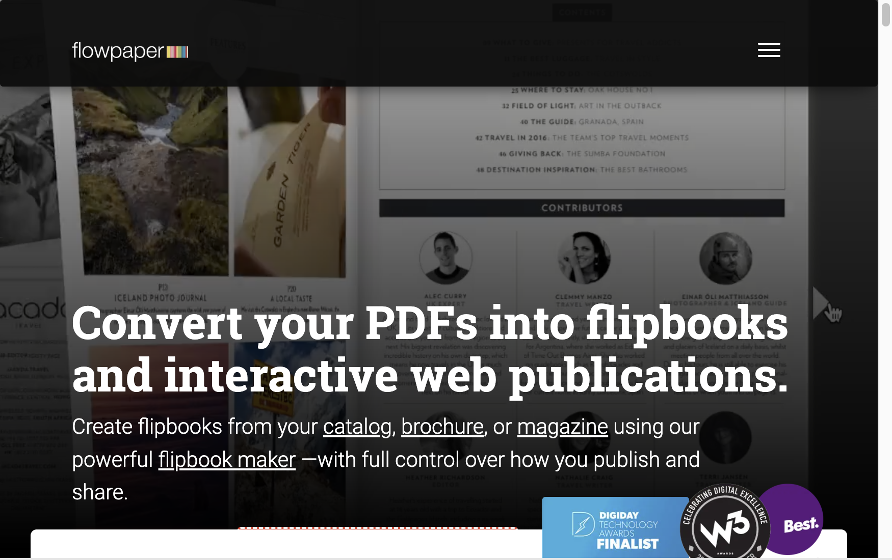
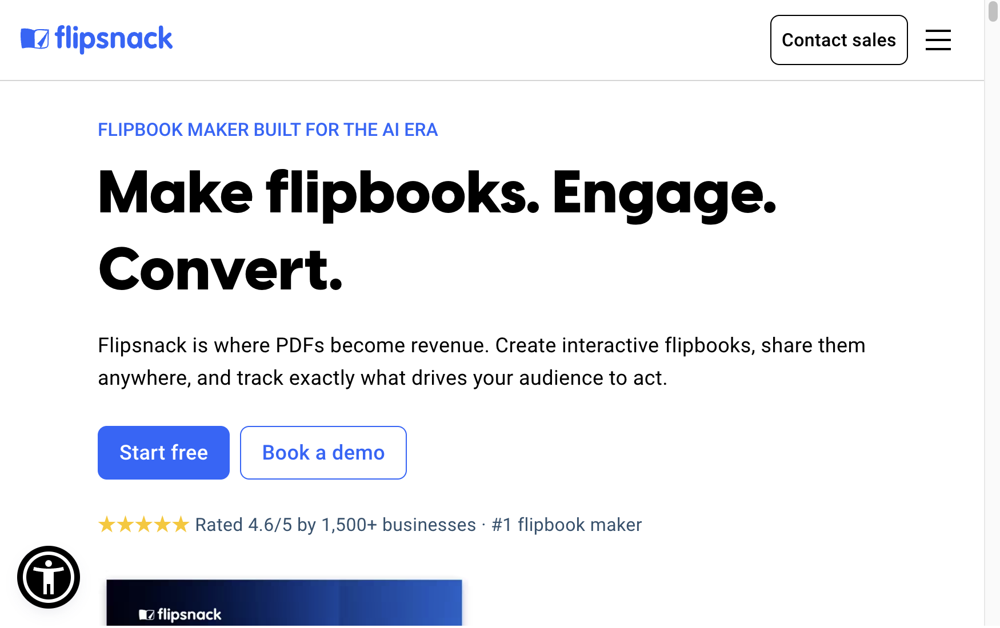
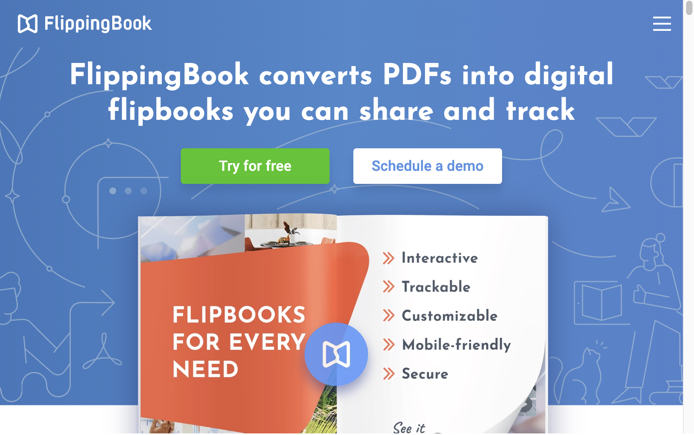
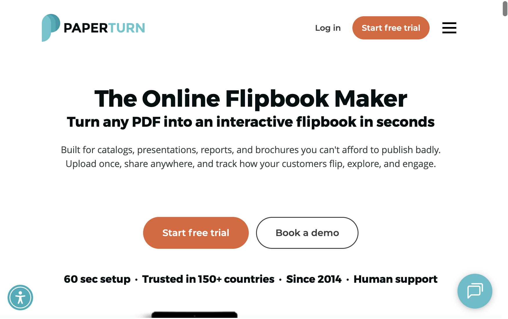
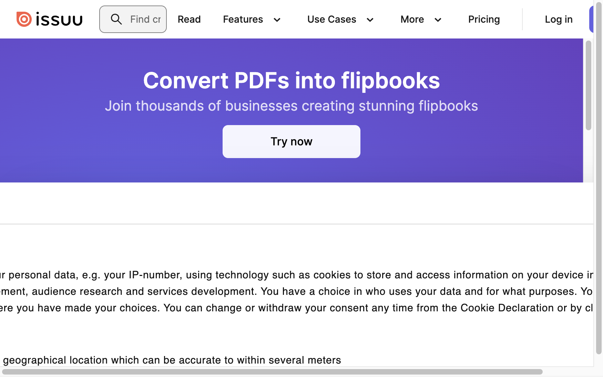
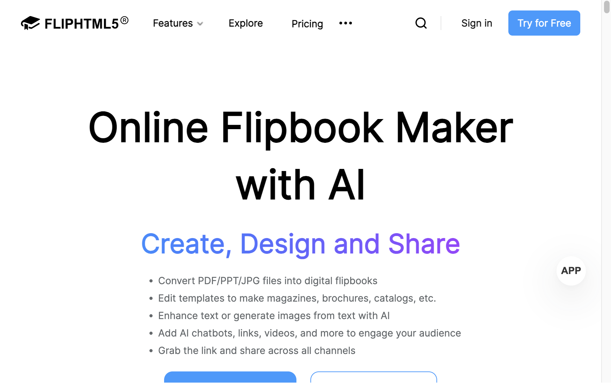
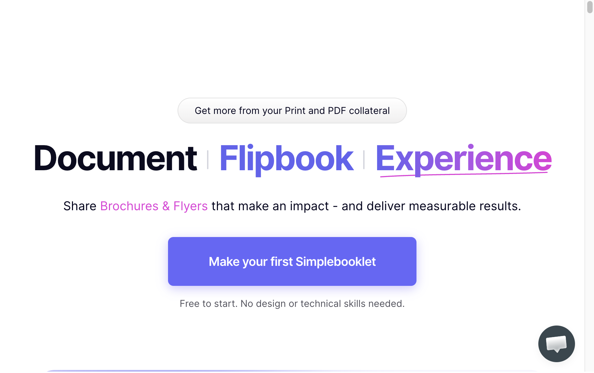

# Top 7 Digital Flipbook Makers Ranked in 2026

Most flipbook makers can turn a PDF into a page-turning publication. The differences become clearer once you look closer: Can readers zoom in on the small print? Where will the publication be hosted? And can you tell which parts people actually use?

Here are seven options for publishing catalogs, brochures, magazines, and reports online. **FlowPaper is our first choice** for its sharp text, flexible hosting, and heatmap analytics, with alternatives for teams that put design, sales, or distribution first.

> **About this ranking:** We considered viewing quality, long-term value, hosting flexibility, and analytics, including heatmaps. The ranking is separate from the third-party user ratings shown below.

## At a glance

| Rank | Flipbook maker | Best for | G2 user rating |
|---|---|---|---|
| 1 | [FlowPaper](https://flowpaper.com/) | Sharp text, hosting flexibility, and heatmaps | [★★★★⯨](https://www.g2.com/products/flowpaper/reviews) |
| 2 | [Flipsnack](https://www.flipsnack.com/) | Creating and collaborating on branded publications | [★★★★⯨](https://www.g2.com/products/flipsnack/reviews) |
| 3 | [FlippingBook](https://flippingbook.com/) | Sales documents and lead tracking | [★★★★⯨](https://www.g2.com/products/flippingbook/reviews) |
| 4 | [Paperturn](https://www.paperturn.com/) | Cloud-based business publications | [★★★★⯨](https://www.g2.com/products/paperturn/reviews) |
| 5 | [Issuu](https://issuu.com/) | Magazine publishing and content distribution | [★★★★⯨](https://www.g2.com/products/issuu/reviews) |
| 6 | [FlipHTML5](https://fliphtml5.com/) | Multimedia flipbooks and budget-conscious publishing | [★★★★⯨](https://www.g2.com/products/flip-html5/reviews) |
| 7 | [Simplebooklet](https://simplebooklet.com/) | Small-business marketing materials | [★★★★⯨](https://www.g2.com/products/simplebooklet-flipbook-experiences/reviews) |

Ratings reflect G2 results indexed as of November 9, 2026, rounded to the nearest half star; ⯨ represents a half star. They can change, so check the linked review pages for exact scores, along with current prices, features, and plan limits.

## 1. [FlowPaper](https://flowpaper.com/) — Best for sharp publications and reader insights

- **Review rating:** [★★★★⯨ on G2](https://www.g2.com/products/flowpaper/reviews)
- **Best for:** Publishers who want clear PDF-based flipbooks, control over hosting, and detailed engagement insights.

FlowPaper starts with the PDF you already have and turns it into a publication readers can open on desktop or mobile. You can customize the viewer, add interactive content, and publish through FlowPaper Cloud or host the files yourself.

### Why FlowPaper takes the top spot

The viewing experience is a big reason for the top ranking. A catalog may look fine at page width, but small specifications and captions need to hold up when someone zooms in. FlowPaper preserves PDF text and vector artwork as scalable content, helping them stay sharp at different magnifications. There's more detail in its [explanation of vector-based rendering](https://online-api.flowpaper.com/blog/flowpaper-4-1-7-sharp-at-every-zoom/).

Its [analytics](https://flowpaper.com/pdf-analytics-and-heatmaps/) go beyond counting opens. Alongside sessions, reading time, and external-link clicks, page-level heatmaps show where recorded interactions occur. That can help you spot areas that attract activity and pages worth revisiting. They don't track eye movement.

For publishers looking to limit ongoing costs, the [Zine license](https://flowpaper.com/download/) is listed at **$55 USD as a one-time fee**. It includes a lifetime Zine license and one year of FlowPaper services. You can self-host your publications, though the best-value option will depend on the features and hosting you need.

There's an important distinction: **heatmaps are included with the Creative offering, not the $55 Zine license**, and require FlowPaper Cloud hosting and enabled data collection. Cloud hosting and upgrades have renewal terms and publication quotas. If a cloud service account isn't renewed, hosted publications enter a grace period and may eventually be removed; that condition doesn't apply to self-hosted publications. Check the [pricing FAQ](https://flowpaper.com/download/) and [analytics guide](https://flowpaper.com/pdf-analytics-and-heatmaps/) for the current details.

FlowPaper won't be the right fit for everyone. If you want to design a publication from scratch with a team inside an online editor, Flipsnack is worth a closer look.

## 2. [Flipsnack](https://www.flipsnack.com/) — Best for design and collaboration

- **Review rating:** [★★★★⯨ on G2](https://www.g2.com/products/flipsnack/reviews)
- **Best for:** Marketing teams creating branded catalogs, magazines, and presentations.

If you don't already have a finished PDF, Flipsnack offers another route: build your publication using its online design tools and templates. It also converts PDFs, so a marketing team can work with both existing material and new designs.

That breadth is appealing, particularly for collaborative work. The tradeoff is that some [GetApp reviewers](https://www.getapp.com/marketing-software/a/flipsnack/) say advanced features sit behind higher-priced tiers and the free version is limited. Price out the features your team will actually use before committing.

## 3. [FlippingBook](https://flippingbook.com/) — Best for sales and business documents

- **Review rating:** [★★★★⯨ on G2](https://www.g2.com/products/flippingbook/reviews)
- **Best for:** Sales, marketing, and HR teams sharing professional documents.

FlippingBook is geared toward documents that need to do more than look good: sales collateral, brochures, presentations, and other materials shared with customers. You can turn a PDF into an online document, add interactive elements, share it by link or embed it, and use features for lead collection and statistics.

It's a sensible shortlist candidate for sales and marketing teams. Check which tracking and security features are included in the plan you need, and weigh the ongoing cost against your publishing volume.

## 4. [Paperturn](https://www.paperturn.com/) — Best for cloud-based business publishing

- **Review rating:** [★★★★⯨ on G2](https://www.g2.com/products/paperturn/reviews)
- **Best for:** Organizations publishing interactive catalogs, reports, and brochures online.

Paperturn brings PDF conversion, interactive elements, access controls, and lead-generation tools into a cloud-hosted service. It's aimed at organizations publishing materials such as catalogs, reports, and brochures.

For teams happy with a hosted workflow, the all-in-one approach may be convenient. Those who want to manage their own hosting should compare it with FlowPaper and check the plan details before deciding.

## 5. [Issuu](https://issuu.com/) — Best for magazines and distribution

- **Review rating:** [★★★★⯨ on G2](https://www.g2.com/products/issuu/reviews)
- **Best for:** Publishers and creators distributing magazines and other editorial content.

Issuu is a familiar name in digital magazines. It's built around uploading, sharing, and embedding publications, making it a natural option for publishers whose priority is distributing editorial content.

The choice comes down partly to the plan: [GetApp's review summary](https://www.getapp.com/website-ecommerce-software/a/issuu/) notes that some users find upgrades expensive and have been frustrated by changes to free features. Check the current limits against how often you publish.

## 6. [FlipHTML5](https://fliphtml5.com/) — Best for multimedia and free-plan exploration

- **Review rating:** [★★★★⯨ on G2](https://www.g2.com/products/flip-html5/reviews)
- **Best for:** Creators who want interactive flipbooks with multimedia.

FlipHTML5 is worth exploring if you want to add multimedia to a PDF-based publication. It offers sharing and customization options, and its free version gives new users a way to get started.

Some [GetApp reviewers](https://www.getapp.com/industries-software/a/fliphtml5/) mention technical issues and free-plan limitations. As with any viewer, try a document with small text and detailed graphics at several zoom levels before making a decision.

## 7. [Simplebooklet](https://simplebooklet.com/) — Best for small-business marketing

- **Review rating:** [★★★★⯨ on G2](https://www.g2.com/products/simplebooklet-flipbook-experiences/reviews)
- **Best for:** Small businesses creating and sharing digital marketing collateral.

Simplebooklet focuses on digital marketing materials that businesses can publish, email, and embed. It also offers built-in lead generation, which may be useful for a small team sharing brochures or other promotional content.

Read the reviews alongside the current plan details and try a representative publication for yourself.

## How to choose a flipbook maker

1. **Test the reading experience.** Upload a representative PDF and zoom in on small text, charts, and images. Compare desktop and mobile viewing rather than judging by a thumbnail.
2. **Compare the full cost.** Look at the plan that includes your required analytics, branding, hosting, users, and publication allowance. One-time licenses and subscriptions have different long-term costs.
3. **Check the analytics.** Page views and reading time answer different questions from link-click tracking or visual heatmaps. Confirm what is included and how tracking is enabled.
4. **Decide where to host.** A hosted platform can simplify sharing; self-hosting can offer more control. Consider what happens to existing publications if you stop paying for a service.
5. **Match the workflow to your team.** A PDF-first publisher, a collaborative design studio, and a sales-document platform solve different problems.

## The bottom line

FlowPaper leads this list because it brings together sharp, scalable text, a self-hosting option, and page-level heatmaps. The $55 one-time Zine license is appealing if you want to self-host; if heatmaps are essential, look at Creative and its FlowPaper Cloud requirements instead.

For collaborative design, a sales-focused workflow, or magazine distribution, Flipsnack, FlippingBook, or Issuu may suit you better. Whichever tools make your shortlist, use the same PDF to try them and compare the plans that include the features you actually need.
